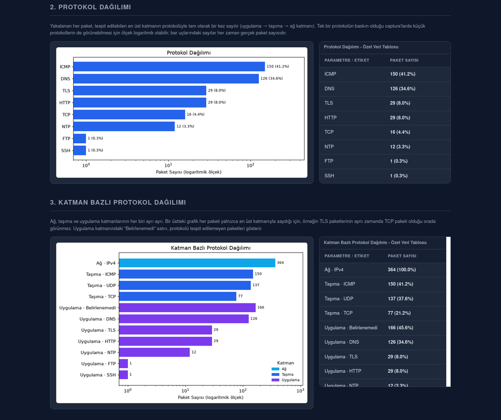

# Automated PCAP Forensic Analysis Tool

[](https://github.com/salihogz/automated-pcap-forensic/actions/workflows/ci.yml)


> An automated PCAP/PCAPNG forensic analysis tool developed in Python for Digital Forensics & Incident Response (DFIR) and Network Security.

> **Project Status:** ✅ Production-Ready — roadmap ~97% complete ([what's left](#development-status))

---

## The Report

> **The generated reports are in Turkish.** This README, the API and the code identifiers are English; the analyst-facing output — report headings, finding descriptions, verdict labels — is Turkish, as are the code comments and docstrings. That is a deliberate convention, not an oversight, and the [verdict labels are translated below](#threat-intelligence-verdicts) so the screenshots and outputs stay readable either way.

A single self-contained HTML file — no external references, no internet required. Every screenshot below is generated from the demo capture in this repository:

```bash
python main.py -f samples/malicious/demo_capture.pcapng
```

**Executive summary and traffic overview** — including the SHA-256 of the source file for chain of custody:


**Protocol breakdown** — two complementary views. The first counts each packet once, by the highest layer identified; the second breaks down all three layers separately, so you can see that the TLS packets are also the TCP packets. The x-axis switches to a logarithmic scale when one protocol dominates — real traffic is routinely 98% HTTPS, and in DFIR the interesting thing is usually the *tail*, not the bulk. Bar labels always carry the true packet count:



**Threat findings** — every finding carries the evidence it was derived from (counts, time window, first/last seen, sampled values), so a reviewer can check the engine's reasoning rather than trusting a verdict:


**Weighted risk summary** — the score is an unbounded weighted sum (CRITICAL 30, HIGH 15, MEDIUM 5, LOW 1), so it keeps rising with the number of findings instead of saturating. The bar tracks the *risk band*, not the raw number, so it can never contradict the label next to it:


---

## Overview

This project automatically analyzes `.pcap` and `.pcapng` files and generates a forensic report containing network statistics, threat detection results, threat intelligence enrichment, and risk assessment. Results can be produced as an offline HTML report, machine-readable JSON, spreadsheet-ready CSV, or a printable PDF, and the whole tool runs from a container.

The primary goal of this project is to improve my Python, DFIR, and software engineering skills while building a production-oriented portfolio project.

The tool is complete and fully operational: **~97% of the planned roadmap is done** (see [Development Status](#development-status)). Future development focuses on adding new detection techniques while preserving the existing architecture.

---

## Installation

Requires **Python 3.14**.

```bash
git clone https://github.com/salihogz/automated-pcap-forensic.git
cd automated-pcap-forensic

python3 -m venv venv
source venv/bin/activate          # Windows: venv\Scripts\activate

pip install -r requirements.txt                       # runtime only
pip install -r requirements.txt -r requirements-dev.txt   # + tests & linting
```

### API keys (optional)

Threat intelligence enrichment reads its keys from a `.env` file in the project root. Start from the tracked template:

```bash
cp .env.example .env    # then fill in the keys you have
```

```dotenv
VT_API_KEY=your_virustotal_key
ABUSEIPDB_API_KEY=your_abuseipdb_key
OTX_API_KEY=your_otx_key
```

A provider with no key configured is **skipped**, not treated as an error — the tool runs fine with no `.env` at all, it just won't enrich IPs. Free tiers are enough to try it: VirusTotal gives 500 lookups/day, AbuseIPDB 1000 checks/day.

Each provider has a **threshold** before its verdict counts as malicious (`config.py`: 3 VirusTotal engines, AbuseIPDB confidence 25, 3 OTX pulses). One or two engines flagging a CDN address is routine noise, so without thresholds ordinary infrastructure gets stamped malicious. The raw score is always reported either way — a below-threshold signal stays visible, it just doesn't become a verdict.

`.env` is gitignored; `.env.example` is the tracked template and must never contain a real key.

### Docker

No Python setup needed — the image pins the interpreter and every dependency, which also means an analysis can be reproduced later with exactly the same toolchain:

```bash
docker build -t pcap-forensic .

# Analyze the demo capture bundled in the image
docker run --rm -v "$PWD/reports:/app/reports" pcap-forensic \
    -f samples/malicious/demo_capture.pcapng --format all

# Analyze your own captures: mount them read-only, write reports back out
docker run --rm \
    --user "$(id -u):$(id -g)" \
    -v "$PWD/samples:/app/samples:ro" \
    -v "$PWD/reports:/app/reports" \
    --env-file .env \
    pcap-forensic -f samples/malicious/your_capture.pcapng --format all
```

Everything after the image name is passed straight to `main.py`, so all the flags above work unchanged.

Notes that affect how you run it:

- **Captures are never baked into the image** — mount them read-only at runtime. Only the synthetic demo capture ships inside, so `docker run` works with no volumes at all.
- **`.env` is never baked in either** — pass it with `--env-file`.
- **The container runs as non-root** (`forensic`, UID 1000). If your host UID isn't 1000, add `--user "$(id -u):$(id -g)"` so files written to the mounted `reports/` belong to you.
- **The container clock is UTC**, so timestamps differ from a host run. Exports carry an explicit offset, so nothing is ambiguous.

---

## Usage

```bash
# Analyze the demo capture shipped with the repository
python main.py -f samples/malicious/demo_capture.pcapng

# No -f: the first capture found under samples/ (searched recursively) is used
python main.py

# DEBUG-level logging
python main.py -v

# Additional output formats (see "Output formats" below)
python main.py --format json
python main.py --format html json pdf
python main.py --format all
```

| Flag | Description |
| --- | --- |
| `-f`, `--file` | Path to the PCAP/PCAPNG file to analyze |
| `-v`, `--verbose` | Enable DEBUG-level logging |
| `--format` | Output formats to produce: `html`, `json`, `csv`, `pdf`, or `all`. Multiple values allowed. Default: `html` |

All outputs are written to `reports/<clean|malicious>/`. The subfolder is derived from the capture's parent directory name (`samples/malicious/x.pcapng` → `reports/malicious/`); anything else falls back to `clean/`.

The HTML report is fully self-contained — charts are embedded as base64, so it has **no external references** and can be opened offline on an air-gapped forensic workstation.

---

## Output formats

| `--format` | Files produced | Intended consumer |
| --- | --- | --- |
| `html` | `<capture>_report.html` | An analyst reading the full report |
| `json` | `<capture>_report.json` | A machine — SIEM ingest, correlation, diffing two analyses |
| `csv` | `<capture>_findings.csv`, `<capture>_threat_intel.csv`, `<capture>_statistics.csv` | Excel/pivot tables, IOC lists, timeline tools |
| `pdf` | `<capture>_report.pdf` | A printed/signed document for a case file |

**Machine formats carry raw data; human formats carry presentation.** JSON and CSV keep every finding as its own record with raw epoch timestamps. HTML and PDF collapse repeated detections of the same rule into one row and format times for reading — a grouped row can't be un-grouped, so the lossless representation is the one that gets exported.

CSV is three files because a single CSV is one flat table and findings / threat-intel / statistics have three different shapes. The statistics file uses a long layout (`category,key,value`) so totals, distributions, top-N lists and the timeline share one schema.

### Threat Intelligence verdicts

Each enriched IP gets one consensus verdict, computed once and reused by every format, so the HTML report and the PDF can never disagree about the same address:

| Label (as printed) | Meaning |
| --- | --- |
| `ZARARLI` | Malicious — every provider that answered crossed its threshold |
| `ÇELİŞKİLİ` | Conflicting — some providers say malicious, others do not |
| `ŞÜPHELİ` | Suspicious — nobody crossed a threshold, but at least one returned a **non-zero** score |
| `KISMİ TEMİZ` | Partially clean — those that answered said clean, but some never answered |
| `VERİ YOK` | No data — no provider could render a verdict |
| `TEMİZ` | Clean — every provider answered and every score was zero |

**A provider that couldn't answer is never counted as clean.** `is_malicious` is tri-state and stays tri-state everywhere: `true`/`false`/`null` in JSON, `true`/`false`/`unknown` in CSV (never a blank cell, which reads as "false"), "no verdict" in the PDF.

### The demo capture

`samples/malicious/demo_capture.pcapng` is committed to the repository so the tool can be run immediately after cloning. It is **synthetic**: every address is from RFC 5737 (TEST-NET) or RFC 1918, so none of it can belong to a real host. It deliberately triggers 7 of the 9 detection rules, and also contains ordinary DNS/NTP response traffic as a regression guard against the port-scan false positive.

Regenerate it (deterministic — same bytes every run) with:

```bash
python scripts/generate_sample_capture.py
```

Any other capture you drop under `samples/` is gitignored, so your own traffic never gets committed by accident.

---

## Current Features

- PCAP / PCAPNG parsing
- Streaming packet parsing (`PcapReader`, never `rdpcap`) — but see [the memory limitation](#known-limitation-memory-on-very-large-captures)
- General traffic statistics
- Protocol statistics
- Rule-based threat detection (9 rules, see below)
- Threat Intelligence enrichment
    - VirusTotal
    - AbuseIPDB
    - AlienVault OTX
- HTML report generation
- JSON / CSV / PDF export (see [Output formats](#output-formats))
- Risk scoring
- Environment-based API configuration (.env)
- Comprehensive error handling
- Unit testing with Pytest
- Static analysis with Ruff

### Detection Rules

| Rule ID | Detects |
| --- | --- |
| `SEC-PORT-SCAN-001` | Many distinct destination ports contacted within a time window |
| `SEC-SYN-SCAN-001` | TCP SYN scanning at the flag level (one source → many ports) |
| `SEC-SYN-FLOOD-001` | Volumetric TCP SYN flood against a single service (grouped by target, since flood sources are usually spoofed) |
| `SEC-ICMP-FLOOD-001` | ICMP flooding |
| `SEC-FAILED-TCP-001` | Bursts of TCP SYNs that were never answered by a SYN-ACK (RST-refused connections count as failed) |
| `SEC-DNS-TUNNEL-001` | DNS tunneling (query volume/entropy per base domain) |
| `SEC-LONG-DOMAIN-001` | Abnormally long domain names |
| `SEC-DGA-001` | Algorithmically generated (DGA) domain names |
| `SEC-EXFIL-001` | Large outbound data transfers to public IPs |

All thresholds and time windows are defined in `config.py`, which is the single source of truth for tunable values.

---

## Technology Stack

**Runtime:** Python 3.14 · Scapy · Requests · urllib3 · Matplotlib · Jinja2 · python-dotenv · ReportLab

**Development:** Pytest · pytest-cov · BeautifulSoup4 (report DOM assertions) · pypdf (PDF text assertions) · Ruff · pip-audit

---

## Project Structure

```
Automated-PCAP-Forensic/
├── modules/                 # parser, statistics, threat_detector, threat_intel, reporter, models
│   └── exporters/           # JSON / CSV / PDF export formats (shared ExportPayload)
├── templates/               # report.html.j2 (Jinja2 view layer)
├── tests/                   # pytest suite + snapshots/
├── reports/                 # generated reports & exports (gitignored)
├── samples/                 # captures (gitignored, except the synthetic demo)
├── scripts/                 # generate_sample_capture.py
├── docs/                    # ARCHITECTURE.md + README screenshots
├── logs/                    # analysis.log (gitignored)
├── .github/workflows/       # CI: ruff + pip-audit + pytest + docker build on every push
├── Dockerfile               # multi-stage build, non-root runtime
├── .dockerignore            # keeps evidence and .env out of the build context
├── .gitattributes           # LF for text, binary for captures (a CRLF rewrite would corrupt evidence)
├── config.py                # thresholds, windows, paths, API config
├── main.py                  # CLI entry point / pipeline orchestration
├── pyproject.toml           # ruff / pytest / coverage configuration
├── requirements.txt         # runtime dependencies
├── requirements-dev.txt     # test & lint dependencies
├── SECURITY.md             # threat model & vulnerability reporting
├── LICENSE
└── README.md
```

---

## Architecture

The pipeline is orchestrated by `main.py` and is single-pass / streaming wherever possible:

```
PCAPParser.parse()           →  list[PacketInfo]
build_general_statistics()   →  GeneralStatistics
ThreatDetector.detect()      →  list[ThreatFinding]
ThreatIntelService.enrich()  →  dict[str, list[NormalizedIOCResult]]   (parallel, public IPs only)
        │
        ├─ Reporter.generate()   →  reports/<clean|malicious>/<name>_report.html
        └─ Exporter.export()     →  ...json / ...csv / ...pdf     (--format)
```

The export formats all consume one `ExportPayload`, built once per run. That is what guarantees the SHA-256 of a multi-gigabyte capture is computed a single time instead of once per output, and that every format reports the same risk score.

Design decisions — what each module owns, which behaviours must not be "simplified" away, and the concrete failure each one prevents — are documented in **[docs/ARCHITECTURE.md](docs/ARCHITECTURE.md)**.

Data contracts live in `modules/models.py` and are shared across every stage. `PacketInfo` and `ThreatFinding` are frozen dataclasses — treated as immutable for chain-of-custody/data-integrity reasons.

---

## Development Status

**Roadmap: ~97% complete.** Every capability the project set out to build is implemented, tested and running in CI. Two items remain, and neither is a gap left by accident — see below.

### Completed

- Parser
- Statistics Engine
- Threat Detection (9 rules)
- Threat Intelligence (3 providers)
- HTML Reporter
- JSON Export
- CSV Export
- PDF Export
- Docker Support
- Test suite (368 tests, 95% coverage)
- Environment-based Configuration
- Comprehensive Error Handling

### Remaining

- **Additional detection rules** — open-ended by nature; a rule set is never "finished". The 9 shipped rules are a baseline, and the architecture (a threshold pair in `config.py` + a private `_detect_*` method) lets a new rule land without touching the existing ones.
- **Chunked processing for very large captures** — deliberately deferred, because getting the window overlap or deduplication wrong produces *silent false negatives*, the worst failure mode a forensic tool can have. See [Known Limitation](#known-limitation-memory-on-very-large-captures); analysis is never refused, only warned about.

---

## Testing

```bash
pytest                                              # full suite
pytest tests/test_parser.py                         # single file
pytest tests/test_parser.py::test_name -v           # single test
pytest --cov --cov-report=html                      # coverage → htmlcov/
ruff check .                                        # lint
pip-audit                                           # dependency vulnerability scan
```

Ruff and pytest are configured in `pyproject.toml`. CI runs lint, a dependency vulnerability scan (`pip-audit`, covering transitive dependencies) and the test suite on every push.

**Current status:** 368 / 368 tests passing · **95%** total coverage (branch coverage enabled)

| Module | Coverage |
| --- | --- |
| `config.py` | 100% |
| `modules/exporters/base.py` | 100% |
| `modules/output_paths.py` | 100% |
| `modules/reporter.py` | 98% |
| `modules/threat_detector.py` | 98% |
| `main.py` | 97% |
| `modules/exporters/pdf_exporter.py` | 95% |
| `modules/models.py` | 94% |
| `modules/statistics.py` | 94% |
| `modules/exporters/csv_exporter.py` | 92% |
| `modules/parser.py` | 92% |
| `modules/exporters/json_exporter.py` | 88% |
| `modules/threat_intel.py` | 86% |

`modules/threat_intel.py` is the lowest — its uncovered lines are mostly provider-specific HTTP error branches. The remaining gaps in `parser.py` are the module-level `ImportError` fallbacks for optional Scapy TLS/HTTP layers, which cannot be exercised without breaking the Scapy install.

The reporter has a snapshot test against `tests/snapshots/report_snapshot.html`. When a template change is intentional, regenerate the baseline instead of hand-editing it, then review the diff:

```bash
UPDATE_SNAPSHOT=1 pytest tests/test_reporter.py -k snapshot
```

---

## Known Limitation: Memory on Very Large Captures

Parsing streams the file (`PcapReader`, never `rdpcap`), but the resulting `PacketInfo` objects are all held in memory, because the detection rules need to see the whole capture.

Measured on a 300k-packet capture with realistic IP diversity: **291 bytes per packet** held after parsing, peaking at ~480 bytes during detection. So roughly:

| Capture | Approx. memory |
| --- | --- |
| 300k packets | ~85 MB |
| 1M packets | ~290 MB |
| 10M packets | ~2.9 GB |

Memory scales with *packet count*, not file size — a capture of small packets holds far more packets per MB. The spread is wide enough that a single number would mislead: a 1.3 GB capture of 5.7 KB packets measured **179 MB** peak RSS (0.14× the file size), while the same 1.3 GB made of minimum-size 64-byte packets would need roughly 5× the file size. Captures above 500 MB therefore log a warning giving that *range*, not one figure. The analysis is **not** refused, since refusing to process a large piece of evidence would be unacceptable in a forensic tool.

The planned fix is chunked processing: every detection rule has a bounded time window (the largest is exfiltration's 300s), so the capture can be split into time slices with an overlap of at least that window, with findings deduplicated across the overlap. This is deferred rather than rushed — getting the overlap or deduplication wrong would produce *silent false negatives*, which is the worst possible failure mode for a forensic tool.

---

## Security

The capture file is **untrusted input** — whoever's traffic is captured controls the domain names and packet contents that end up in the report, and the person at risk is the analyst who opens it. Two real attacks in that class have already been found and fixed (spreadsheet formula injection through a threat-intel tag, and a hostname that suppressed report generation entirely). See [SECURITY.md](SECURITY.md) for the threat model, the defences in place, and how to report a vulnerability.

---

## Development Principles

This project follows:

- SOLID Principles
- Streaming Architecture (file is never read into memory whole)
- Fail-Fast Error Handling
- Type Hints
- Dataclasses
- Modular Design
- Production-oriented project structure
- Environment-based configuration
- Backward compatibility whenever possible

---

## Development Process

This project is developed as a hands-on learning and portfolio project with a strong focus on software engineering best practices.

External development tools may be used for research, architecture discussions, documentation, and code review. All design decisions, implementations, testing, and final integration are performed manually before becoming part of the project.

---

## License

MIT License
