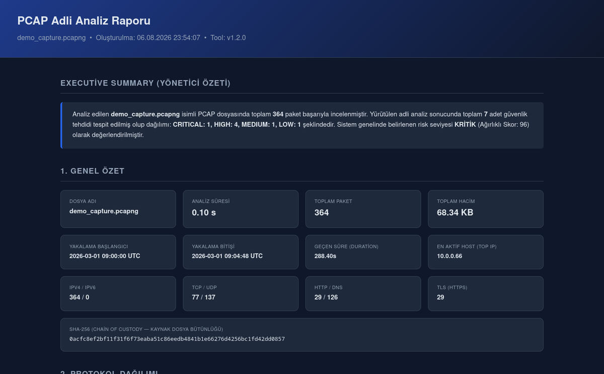
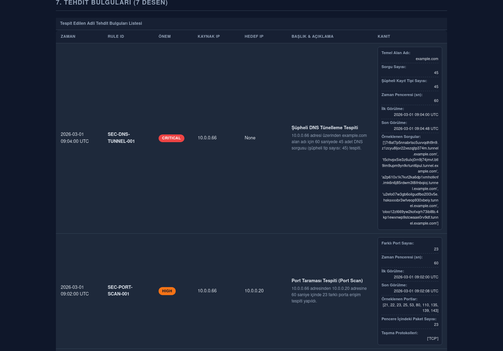
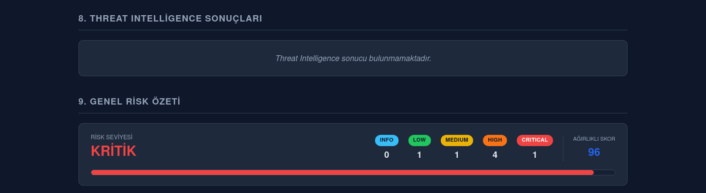

# Automated PCAP Forensic Analysis Tool

[](https://github.com/salihogz/automated-pcap-forensic/actions/workflows/ci.yml)


> An automated PCAP/PCAPNG forensic analysis tool developed in Python for Digital Forensics & Incident Response (DFIR) and Network Security.

> **Project Status:** ✅ Production-Ready (Core Features Completed)

---

## The Report

A single self-contained HTML file — no external references, no internet required. Every screenshot below is generated from the demo capture in this repository:

```bash
python main.py -f samples/malicious/demo_capture.pcapng
```

**Executive summary and traffic overview** — including the SHA-256 of the source file for chain of custody:



**Threat findings** — every finding carries the evidence it was derived from (counts, time window, first/last seen, sampled values), so a reviewer can check the engine's reasoning rather than trusting a verdict:



**Weighted risk summary:**



---

## Overview

This project automatically analyzes `.pcap` and `.pcapng` files and generates a forensic report containing network statistics, threat detection results, threat intelligence enrichment, and risk assessment.

The primary goal of this project is to improve my Python, DFIR, and software engineering skills while building a production-oriented portfolio project.

The core functionality of the project has been completed and is fully operational. Future development will focus on adding new detection techniques, export formats, and feature enhancements while preserving the existing architecture.

---

## Installation

Requires **Python 3.14**.

```bash
git clone https://github.com/salihogz/automated-pcap-forensic.git
cd automated-pcap-forensic

python3 -m venv venv
source venv/bin/activate          # Windows: venv\Scripts\activate

pip install -r requirements.txt                       # runtime only
pip install -r requirements.txt -r requirements-dev.txt   # + tests & linting
```

### API keys (optional)

Threat intelligence enrichment reads its keys from a `.env` file in the project root. A provider with no key configured is **skipped**, not treated as an error — the tool runs fine with no `.env` at all, it just won't enrich IPs.

```dotenv
VT_API_KEY=your_virustotal_key
ABUSEIPDB_API_KEY=your_abuseipdb_key
OTX_API_KEY=your_otx_key
```

---

## Usage

```bash
# Analyze the demo capture shipped with the repository
python main.py -f samples/malicious/demo_capture.pcapng

# No -f: the first capture found under samples/ (searched recursively) is used
python main.py

# DEBUG-level logging
python main.py -v
```

| Flag | Description |
| --- | --- |
| `-f`, `--file` | Path to the PCAP/PCAPNG file to analyze |
| `-v`, `--verbose` | Enable DEBUG-level logging |

The HTML report is written to `reports/<clean|malicious>/<capture-name>_report.html`. The subfolder is derived from the capture's parent directory name (`samples/malicious/x.pcapng` → `reports/malicious/x_report.html`); anything else falls back to `clean/`.

The report is fully self-contained — charts are embedded as base64, so it has **no external references** and can be opened offline on an air-gapped forensic workstation.

### The demo capture

`samples/malicious/demo_capture.pcapng` is committed to the repository so the tool can be run immediately after cloning. It is **synthetic**: every address is from RFC 5737 (TEST-NET) or RFC 1918, so none of it can belong to a real host. It deliberately triggers 7 of the 8 detection rules, and also contains ordinary DNS/NTP response traffic as a regression guard against the port-scan false positive.

Regenerate it (deterministic — same bytes every run) with:

```bash
python scripts/generate_sample_capture.py
```

Any other capture you drop under `samples/` is gitignored, so your own traffic never gets committed by accident.

---

## Current Features

- PCAP / PCAPNG parsing
- Streaming packet parsing (`PcapReader`, never `rdpcap`) — but see [the memory limitation](#known-limitation-memory-on-very-large-captures)
- General traffic statistics
- Protocol statistics
- Rule-based threat detection (8 rules, see below)
- Threat Intelligence enrichment
    - VirusTotal
    - AbuseIPDB
    - AlienVault OTX
- HTML report generation
- Risk scoring
- Environment-based API configuration (.env)
- Comprehensive error handling
- Unit testing with Pytest
- Static analysis with Ruff

### Detection Rules

| Rule ID | Detects |
| --- | --- |
| `SEC-PORT-SCAN-001` | Many distinct destination ports contacted within a time window |
| `SEC-SYN-SCAN-001` | TCP SYN scanning at the flag level |
| `SEC-ICMP-FLOOD-001` | ICMP flooding |
| `SEC-FAILED-TCP-001` | Bursts of failed TCP connection attempts |
| `SEC-DNS-TUNNEL-001` | DNS tunneling (query volume/entropy per base domain) |
| `SEC-LONG-DOMAIN-001` | Abnormally long domain names |
| `SEC-DGA-001` | Algorithmically generated (DGA) domain names |
| `SEC-EXFIL-001` | Large outbound data transfers to public IPs |

All thresholds and time windows are defined in `config.py`, which is the single source of truth for tunable values.

---

## Technology Stack

**Runtime:** Python 3.14 · Scapy · Requests · urllib3 · Matplotlib · Jinja2 · python-dotenv

**Development:** Pytest · pytest-cov · BeautifulSoup4 (report DOM assertions) · Ruff · pip-audit

---

## Project Structure

```
Automated-PCAP-Forensic/
├── modules/                 # parser, statistics, threat_detector, threat_intel, reporter, models
├── templates/               # report.html.j2 (Jinja2 view layer)
├── tests/                   # pytest suite + snapshots/
├── reports/                 # generated HTML reports (gitignored)
├── samples/                 # captures (gitignored, except the synthetic demo)
├── scripts/                 # generate_sample_capture.py
├── docs/                    # README screenshots
├── logs/                    # analysis.log (gitignored)
├── .github/workflows/       # CI: ruff + pip-audit + pytest on every push
├── config.py                # thresholds, windows, paths, API config
├── main.py                  # CLI entry point / pipeline orchestration
├── pyproject.toml           # ruff / pytest / coverage configuration
├── requirements.txt         # runtime dependencies
├── requirements-dev.txt     # test & lint dependencies
├── LICENSE
└── README.md
```

---

## Architecture

The pipeline is orchestrated by `main.py` and is single-pass / streaming wherever possible:

```
PCAPParser.parse()           →  list[PacketInfo]
build_general_statistics()   →  GeneralStatistics
ThreatDetector.detect()      →  list[ThreatFinding]
ThreatIntelService.enrich()  →  dict[str, list[NormalizedIOCResult]]   (parallel, public IPs only)
Reporter.generate()          →  reports/<clean|malicious>/<name>_report.html
```

Data contracts live in `modules/models.py` and are shared across every stage. `PacketInfo` and `ThreatFinding` are frozen dataclasses — treated as immutable for chain-of-custody/data-integrity reasons.

---

## Development Status

### Completed

- Parser
- Statistics Engine
- Threat Detection
- Threat Intelligence
- HTML Reporter
- Threat Intelligence Test Suite
- Environment-based Configuration
- Comprehensive Error Handling

### Planned

- Additional Detection Rules
- JSON Export
- CSV Export
- PDF Export
- Docker Support
- **Chunked processing for very large captures** — see below

---

## Testing

```bash
pytest                                              # full suite
pytest tests/test_parser.py                         # single file
pytest tests/test_parser.py::test_name -v           # single test
pytest --cov --cov-report=html                      # coverage → htmlcov/
ruff check .                                        # lint
pip-audit                                           # dependency vulnerability scan
```

Ruff and pytest are configured in `pyproject.toml`. CI runs lint, a dependency vulnerability scan (`pip-audit`, covering transitive dependencies) and the test suite on every push.

**Current status:** 213 / 213 tests passing · **92%** total coverage (branch coverage enabled)

| Module | Coverage |
| --- | --- |
| `config.py` | 100% |
| `modules/threat_detector.py` | 97% |
| `main.py` | 96% |
| `modules/models.py` | 94% |
| `modules/statistics.py` | 93% |
| `modules/parser.py` | 92% |
| `modules/reporter.py` | 89% |
| `modules/threat_intel.py` | 86% |

`modules/threat_intel.py` is the lowest — its uncovered lines are mostly provider-specific HTTP error branches. The remaining gaps in `parser.py` are the module-level `ImportError` fallbacks for optional Scapy TLS/HTTP layers, which cannot be exercised without breaking the Scapy install.

The reporter has a snapshot test against `tests/snapshots/report_snapshot.html`. When a template change is intentional, regenerate the baseline instead of hand-editing it, then review the diff:

```bash
UPDATE_SNAPSHOT=1 pytest tests/test_reporter.py -k snapshot
```

---

## Known Limitation: Memory on Very Large Captures

Parsing streams the file (`PcapReader`, never `rdpcap`), but the resulting `PacketInfo` objects are all held in memory, because the detection rules need to see the whole capture.

Measured on a 300k-packet capture with realistic IP diversity: **291 bytes per packet** held after parsing, peaking at ~480 bytes during detection. So roughly:

| Capture | Approx. memory |
| --- | --- |
| 300k packets | ~85 MB |
| 1M packets | ~290 MB |
| 10M packets | ~2.9 GB |

Memory scales with *packet count*, not file size — a capture of small packets holds far more packets per MB. Captures above 500 MB log a warning with an estimate; the analysis is **not** refused, since refusing to process a large piece of evidence would be unacceptable in a forensic tool.

The planned fix is chunked processing: every detection rule has a bounded time window (the largest is exfiltration's 300s), so the capture can be split into time slices with an overlap of at least that window, with findings deduplicated across the overlap. This is deferred rather than rushed — getting the overlap or deduplication wrong would produce *silent false negatives*, which is the worst possible failure mode for a forensic tool.

---

## Development Principles

This project follows:

- SOLID Principles
- Streaming Architecture (file is never read into memory whole)
- Fail-Fast Error Handling
- Type Hints
- Dataclasses
- Modular Design
- Production-oriented project structure
- Environment-based configuration
- Backward compatibility whenever possible

---

## Development Process

This project is developed as a hands-on learning and portfolio project with a strong focus on software engineering best practices.

External development tools may be used for research, architecture discussions, documentation, and code review. All design decisions, implementations, testing, and final integration are performed manually before becoming part of the project.

---

## License

MIT License
